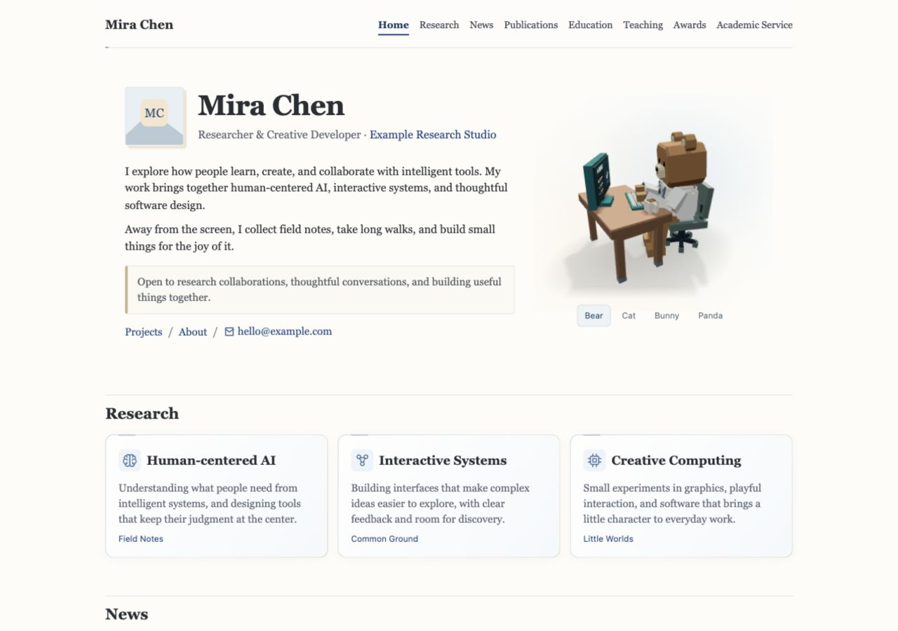
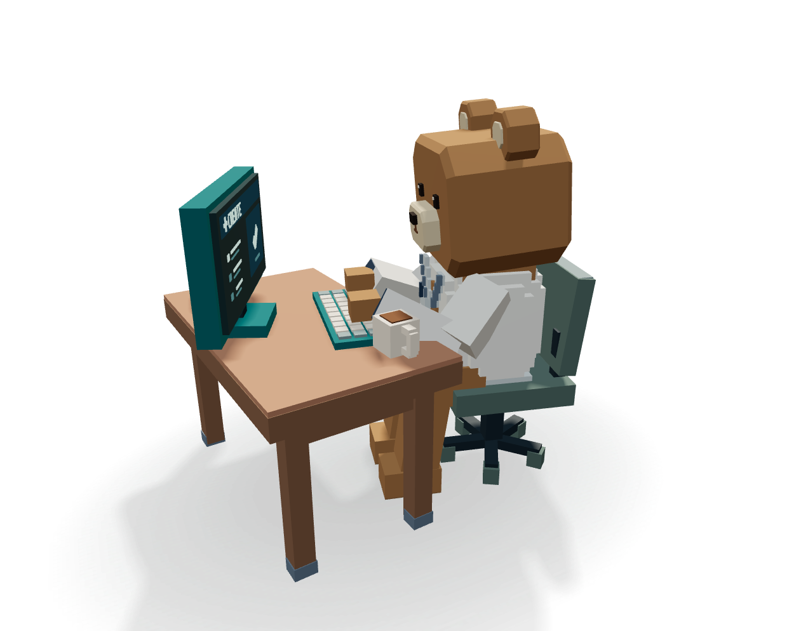
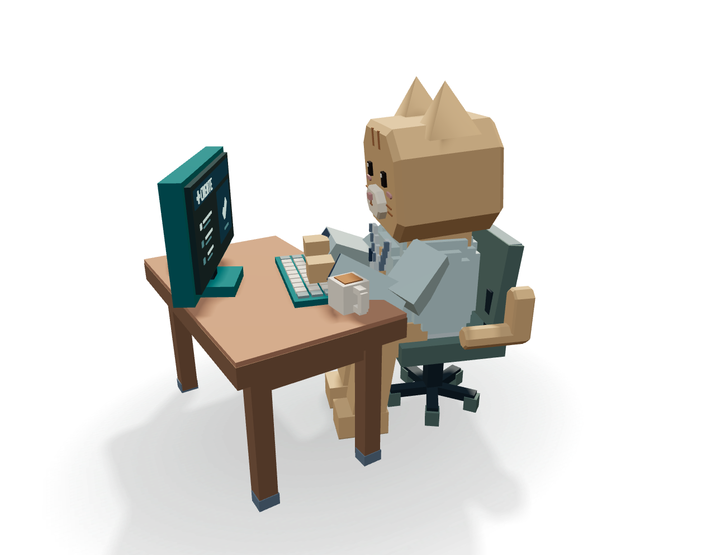
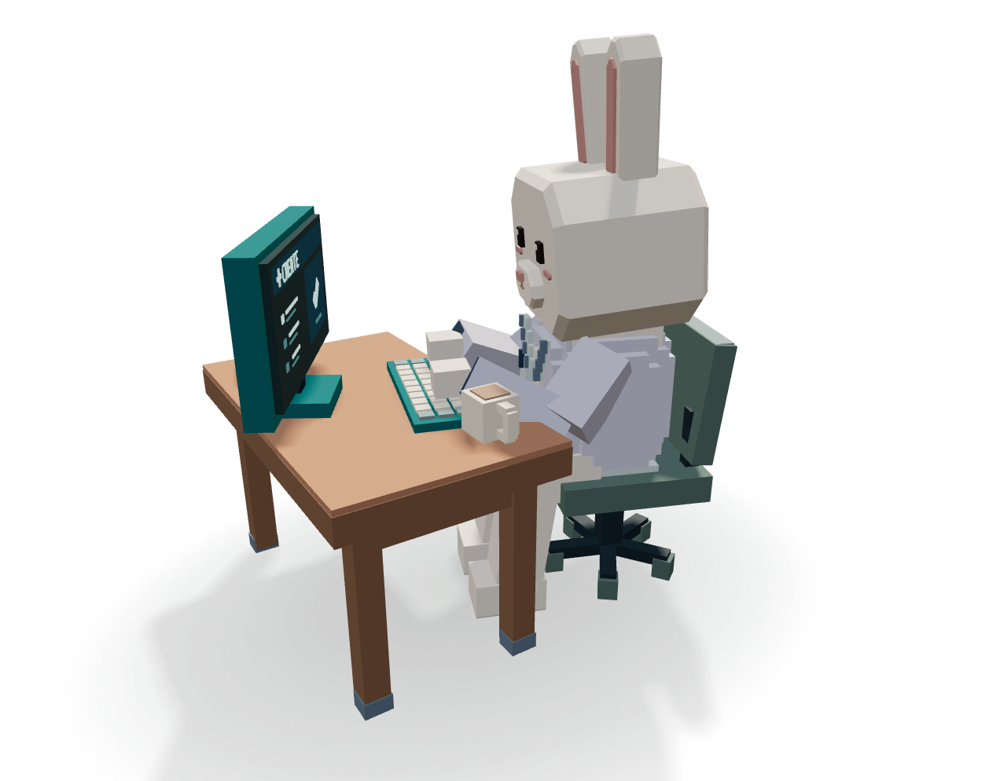
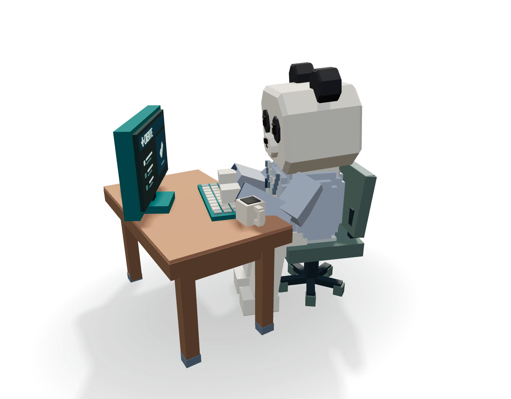
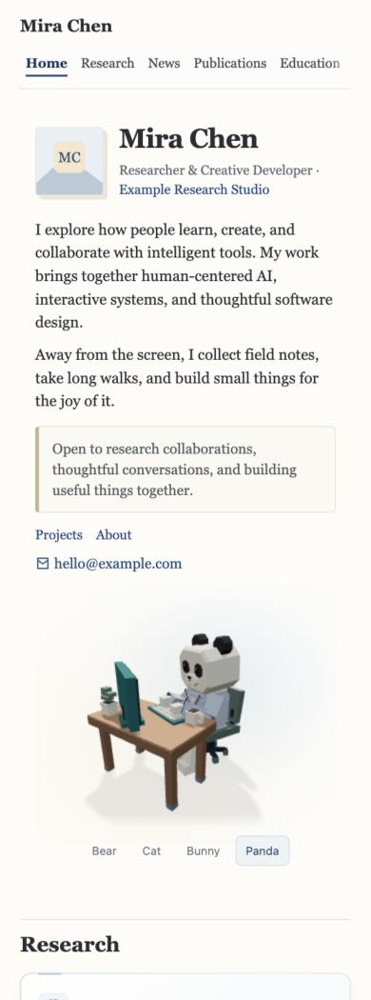

# cozy-homepage

A personal homepage with an interactive voxel companions, quiet typography, and space for your work.

[简体中文](README.zh-CN.md) · [Customize](docs/customization.md) · [Deploy](docs/deployment.md) · [Animal source](tools/build-companion.mjs)

[**Live demo →**](https://lanqz7766.github.io/cozy-homepage/)



Choose a bear, cat, bunny, or panda to keep you company at the desk. Your writing, projects, and research stay in the foreground.

- Drag the scene to rotate it; each companion gently alternates its paws at the keyboard.
- Edit one data file for your profile, research, news, publications, education, awards, and service.
- Responsive layout, keyboard rotation, reduced-motion support, and a static image fallback.
- Plain HTML, CSS, and JavaScript. No framework, account, or site-build dependency required.
- Four original procedural animals, prebuilt models, and matching fallback images included.
- No analytics, visitor widget, cookies, or third-party fonts included. The 3D viewer loads version-pinned Three.js modules from jsDelivr.

## Run locally

Requires Node.js 20 or newer. From the repository folder:

```sh
npm run dev
```

Open **http://127.0.0.1:8040**. No `npm install` is needed to preview the included site. Opening `index.html` with `file://` will not reliably load the 3D model; use the local server.

Prefer Python? `python3 -m http.server 8040 --bind 127.0.0.1` works too.

## Make it yours

1. Edit [`data/content.js`](data/content.js): name, bio, links, sections, and featured work.
2. Replace `assets/img/avatar.svg` with your portrait or illustration and update `profile.avatar`.
3. Replace the sample project illustrations and `example.com` links. The demo profile, affiliations, publications, and awards are fictional.
4. Adjust `src/theme.css` for colors; original typography and responsive layout live in `src/styles.css`.
5. Update the HTML title, description, static fallback name, favicon, and publication legend in `index.html`.

The demo's **Mira Chen** is an illustrative persona, not the author's identity. Add only your own achievements. The demo includes four small animal switches. Fix your favorite animal and remove the switcher for a quieter personal homepage.

See [customization](docs/customization.md) for field examples, optional sections, and accessibility behavior.

## Meet your companions

| Bear | Cat | Bunny | Panda |
| --- | --- | --- | --- |
|  |  |  |  |

Set `data-companion="cat"` on the scene in `index.html` to choose a default. Remove the `.companion-picker` element to keep one animal. See [the companion guide](docs/companions.md) for matching static fallbacks.

## The animals are source, too

The four animals, chair, desk, keyboard, screen, mug, plant, and typing animation are built procedurally in [`tools/build-companion.mjs`](tools/build-companion.mjs).

```sh
npm ci                 # only needed to rebuild models
npm run build:models
```

This writes four GLBs into `assets/scenes/`. Change the material palette or `makeCompanionHead` for the animals, and `makeChair` / `makeTerminal` for the workstation. To rebuild one animal: `node tools/build-companion.mjs cat`.

Run the local server and open `/tools/scene-studio.html` to export matching transparent PNG posters.

Camera, lighting, rotation, animation, and fallback behavior live in `src/station.js`. See [the model guide](docs/companions.md) before replacing the GLB. Regenerate the poster if you change the model's appearance.

## Deploy

```sh
npm run check
npm run build
```

Upload the contents of `dist/` to a static host. All asset paths are relative, so repository subpaths work. The demo is deployed from a separate `gh-pages` branch containing only `dist/`. An optional [GitHub Actions workflow](docs/github-pages-workflow.yml) is included for automated deployment. See [deployment instructions](docs/deployment.md) for GitHub Pages, Netlify, and other static hosts.

## Project layout

```text
index.html                Page structure and metadata
src/main.js               Content rendering and page interactions
src/station.js            Three.js viewer and typing loop
src/*.css                 Layout, palette, scene, and service styles
data/content.js           Editable demo profile
assets/scenes/            Four animated GLBs and fallback posters
assets/img/               Original example illustrations
tools/build-companion.mjs       Procedural model source
tools/check.mjs            Syntax, asset, anchor, and GLB checks
```

## Mobile preview



## Credits and license

Created by **Qizhen Lan**, extracted from [his personal homepage](https://lanqz7766.github.io/). The bear began as an original ClinAgent mascot. The template adds three animal variants and uses generic screen lettering. The character geometry and animation are included under this project's MIT license.

Visual inspiration: [craftzdog-homepage](https://github.com/craftzdog/craftzdog-homepage) for a small interactive scene alongside personal writing, and clean academic homepage layouts. No craftzdog model is bundled.

Project code and original assets: [MIT](LICENSE). Three.js and Feather-derived line icons retain their own MIT notices; see [THIRD_PARTY_NOTICES.md](THIRD_PARTY_NOTICES.md). No personal photos, CV, institution marks, paper figures, contact QR codes, or tracking IDs from the original homepage are included.

If you make something with it, share a screenshot in the repository's issues. A star is welcome if the project helped you.
