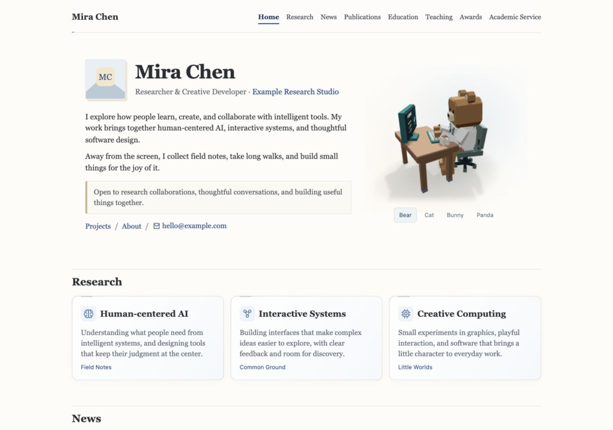
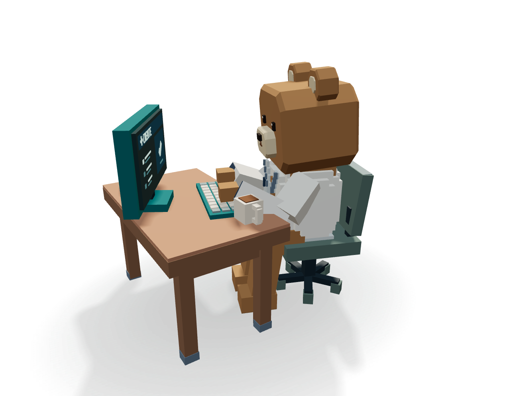
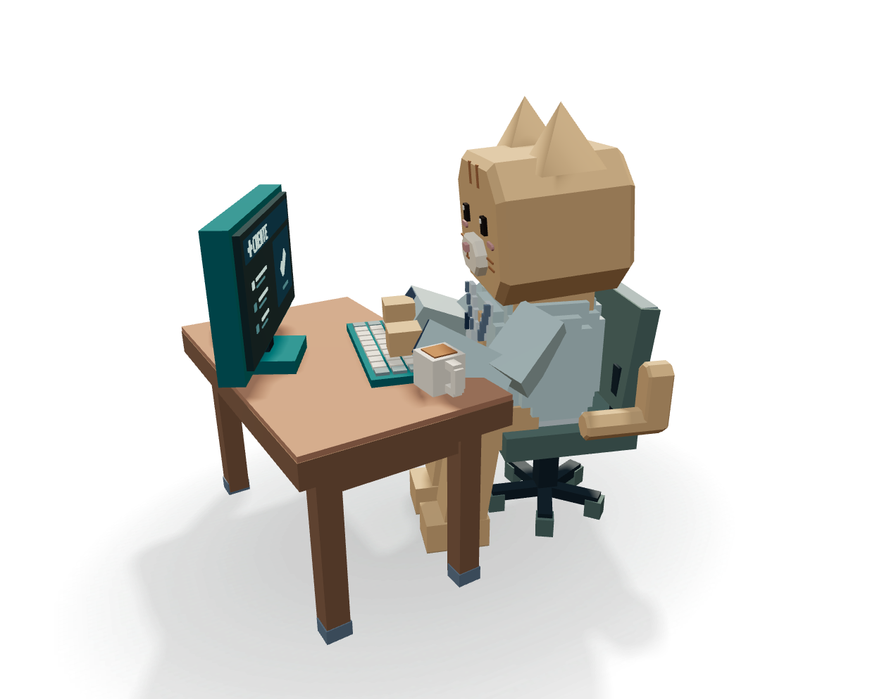
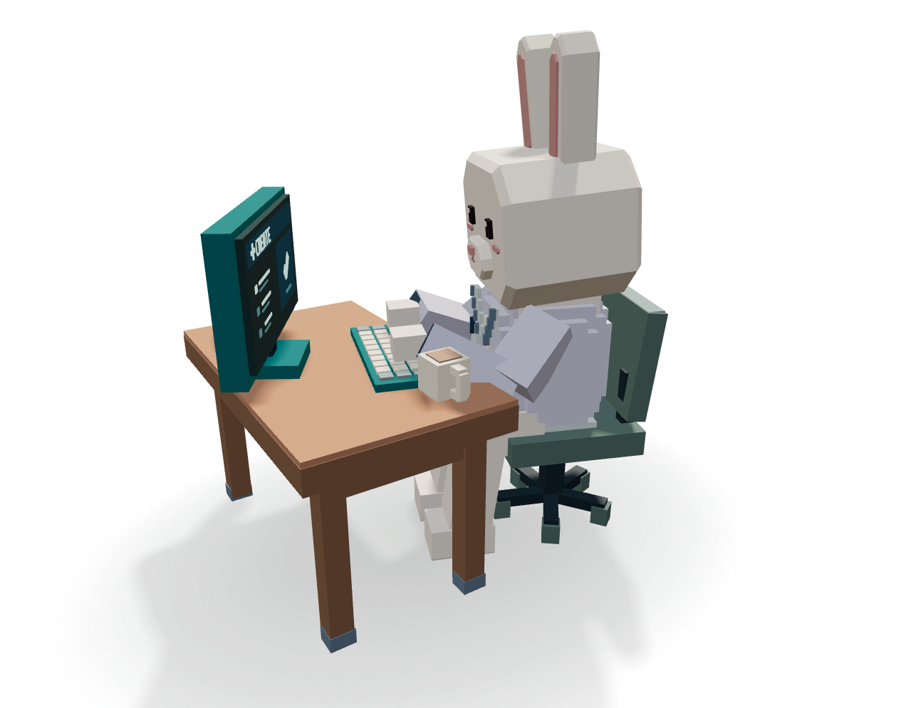
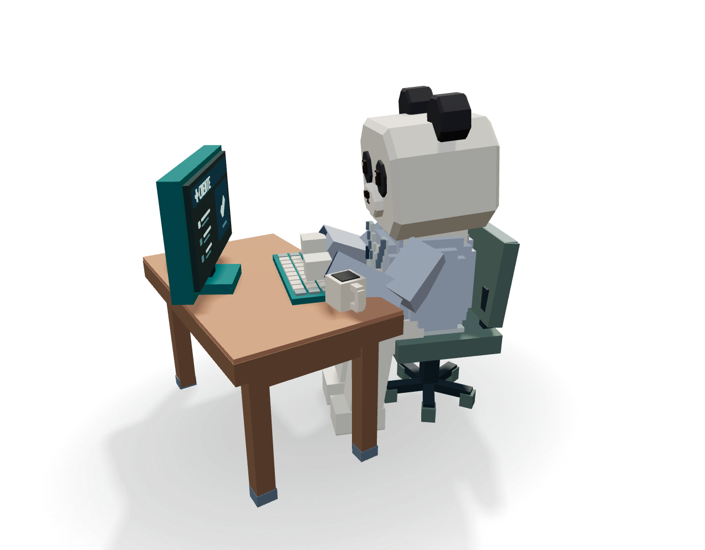
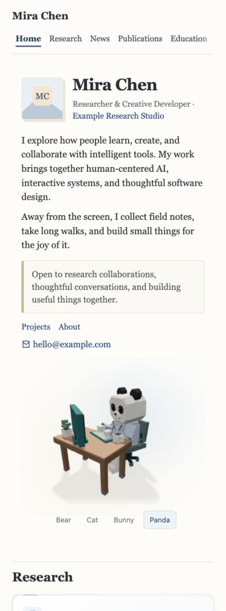

# cozy-homepage

一个带互动体素动物伙伴的个人主页模板。保留安静的排版，把空间留给你的作品、研究和近况。

[English](README.md) · [自定义](docs/customization.md) · [部署](docs/deployment.md) · [动物源码](tools/build-companion.mjs)

[**在线演示 →**](https://lanqz7766.github.io/cozy-homepage/)



小熊、小猫、兔子和熊猫在工作台前轻轻敲键盘，你可以拖动旋转它。页面使用普通 HTML、CSS 和 JavaScript，不需要换框架，也没有复杂的构建步骤。

- 一份资料文件管理简介、研究、动态、论文、教育、奖项和学术服务。
- 桌面端左文右景，手机端自然上下排列。
- 支持键盘方向键、减少动态效果偏好，以及 3D 加载失败时的静态后备图。
- 包含四种动物的建模源码、动画、可直接使用的 GLB 和静态后备图。
- 默认不包含统计、访客地图、Cookie 或外部字体；3D 库通过 jsDelivr 加载固定版本。

## 本地运行

需要 Node.js 20 或更新版本，在项目目录运行：

```sh
npm run dev
```

打开 **http://127.0.0.1:8040**。预览现成模板不需要先安装依赖。

也可以使用 `python3 -m http.server 8040 --bind 127.0.0.1`。不要直接双击 HTML，`file://` 下 3D 资源可能无法加载。

## 换成自己的主页

1. 编辑 [`data/content.js`](data/content.js)，替换姓名、简介、内容和链接。
2. 替换头像及作品图片，并更新对应资源路径。
3. 将所有 `example.com` 链接换成真实地址。示例人物 Mira Chen、机构、论文和奖项均为虚构内容。
4. 在 `src/theme.css` 中调整配色；排版和字体在 `src/styles.css`。
5. 更新 `index.html` 的标题、描述、静态姓名、favicon 和论文示例说明。

页面提供四个轻量动物切换按钮，可以删除切换栏并固定自己喜欢的角色。鼠标和触屏可以直接拖动；用 Tab 聚焦小熊后，左右方向键也可以旋转。

详见[自定义指南](docs/customization.md)。

## 四种动物伙伴

| 小熊 | 小猫 | 兔子 | 熊猫 |
| --- | --- | --- | --- |
|  |  |  |  |

在 `index.html` 的场景上设置 `data-companion="cat"` 即可选择默认角色。删除 `.companion-picker` 元素即可隐藏切换栏，同时需要同步 HTML 中的静态图片及替代文字。

## 修改动物

```sh
npm ci
npm run build:models
```

只有重新生成模型才需要安装依赖。建模源码是 [`tools/build-companion.mjs`](tools/build-companion.mjs)，输出为 `assets/scenes/` 下四个动物 GLB。单独生成小猫可运行 `node tools/build-companion.mjs cat`。

源码包括四种角色、服装、椅子、工作台和两只爪子的交替打字动画。文件顶部是材质配色，`makeCompanionHead` 负责新增动物的头部，`makeBear` 负责身体和小熊，`makeChair` 与 `makeTerminal` 负责椅子和工作台。

启动本地服务后，打开 `/tools/scene-studio.html`，选择动物并导出透明 PNG，放回 `assets/scenes/` 对应的后备图路径。

相机、灯光、交互和动画循环在 `src/station.js`。修改外观后还需要更新后备图片，详见[模型指南](docs/companions.md)。

## 部署

```sh
npm run check
npm run build
```

把 `dist/` 的内容交给静态托管服务即可。在线 demo 使用独立的 `gh-pages` 静态发布分支；另附可选 Actions 工作流示例。配置方法以及其他托管平台说明见[部署指南](docs/deployment.md)。

## 手机端预览



## 来源与许可证

由 **Qizhen Lan** 从[个人主页](https://lanqz7766.github.io/)提取。小熊最初是原创 ClinAgent 形象，模板新增三种动物，并将屏幕文字换成通用内容；几何与动画均随项目按 MIT 许可证提供。

参考了 [craftzdog-homepage](https://github.com/craftzdog/craftzdog-homepage) 将互动小场景融入个人主页的设计思路，没有打包其角色模型。

代码和原创素材使用 [MIT](LICENSE)。Three.js 与部分源自 Feather 的线条图标保留各自的 MIT 声明，见 [THIRD_PARTY_NOTICES.md](THIRD_PARTY_NOTICES.md)。模板未包含原主页的个人照片、CV、机构标志、论文图片、联系二维码或统计 ID。

如果你用它做了自己的主页，欢迎在仓库 issue 里分享截图。喜欢这个项目也可以点个 Star。
